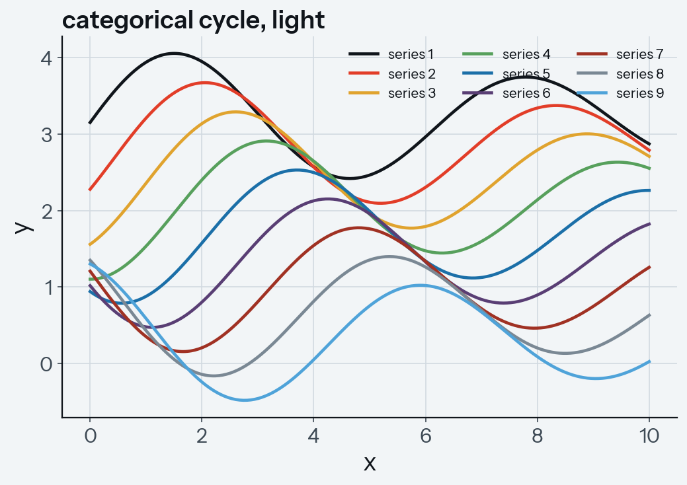
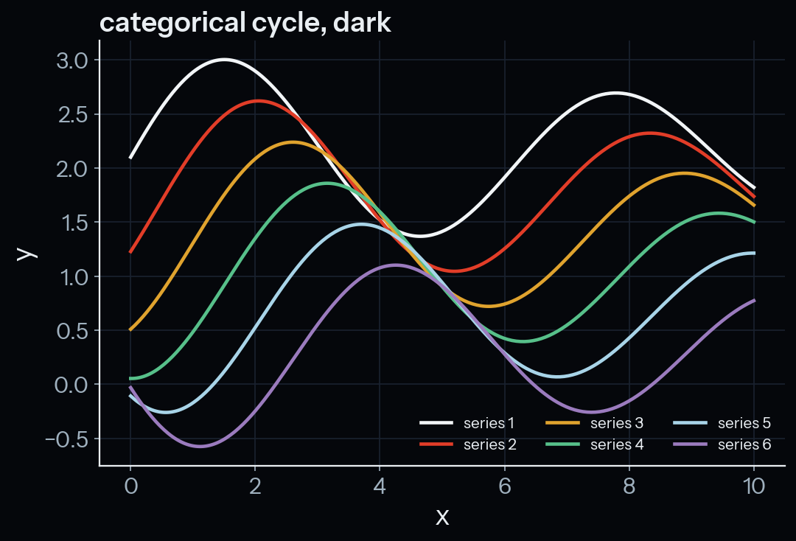

# proteus-mpl

PROTEUS Thermocline matplotlib theme. Publication-grade figures whose colors,
fonts, and surfaces match the slides, the website, and the docs.

## Install

```bash
pip install proteus-mpl
```

From a checkout of the repository: `pip install figures/proteus-mpl` (or cd
into the folder and `pip install .`).

## Use

```python
import proteus_mpl
proteus_mpl.use()           # light: Paper background — papers, light slides
# proteus_mpl.use("dark")   # dark: Void background — dark slides, hero figures
# proteus_mpl.use("white")  # light theme on pure white — journal pages
```

## What you get

- **Cycles** — both neutral-first, so a single-series plot draws in ink
  (light) / paper (dark) and magma stays a deliberate signal. Light
  (`proteus_mpl.CYCLE`, 9 colours): ink, magma, solar, verdant, ocean, tidal,
  outgassing, fog, azure; CVD worst-pair ΔE 15.7 (Machado 2009). Dark
  (`CYCLE_DARK`, 6 colours): paper, magma, solar, and light-safe tones; ΔE
  16.8. Past the cycle, switch line style (solid/dashed/dotted/dash-dot)
  instead of adding hues, and keep legends on multi-series plots.
- **Accents** — `COLORS["solar"]` (`#E0A32E`, the star) with
  `COLORS["solar_deep"]` (`#C8860F`) for gold fills or thin marks on light
  surfaces, and `COLORS["verdant"]` (`#57A05C`, the habitable endpoint).
- **Module domain colors** — `proteus_mpl.DOMAINS["interior"]` etc, seven of
  them. Use these whenever a line *is* a module (SPIDER output → interior red,
  MORS → solar gold, Morrigan → accretion clay `#A38F7A`). Stable across every
  paper, talk, and diagram. Three of them are light in tone and thin out on a
  pale page: stellar gold at 2.0:1, atmosphere blue at 2.5:1, and accretion clay
  at 2.8:1 against Paper. Give those a legend rather than leaning on the hue for
  small marks.
- **Colormaps** — `proteus` (sequential, Void→Paper; default for imshow /
  pcolormesh; the one ramp that survives greyscale reproduction),
  `proteus_div` (diverging, light midpoint — print-safe for
  anomalies/residuals), `proteus_phase` (the brand ramp, magma→void→ocean,
  dark midpoint — hero figures and dark slides). `_r` reversals registered.
- **Type** — Instrument Sans labels, Spline Sans Mono available for ticks via
  `fontfamily="Spline Sans Mono"`; titles bold, left-aligned. The OFL brand
  fonts ship inside the package and register automatically on `use()`.
- **Publication settings** — 300 dpi savefig, tight bbox, TrueType embedding
  (fonttype 42), text-as-paths SVG. Prefer `fig.savefig("fig.pdf")`.

## The cycle on each surface




Regenerate with `python examples/cycle.py`.

## Validation plots

`proteus_mpl.validation.save` writes one validation plot as a light and a dark file, with the same bytes each time the same figure is drawn, so the files can be committed next to the docs:

```python
from proteus_mpl.validation import save

def make_figure():
    fig, ax = plt.subplots()
    ax.plot(t, model, label="model")
    ax.plot(t_ref, ref, "o", label="reference")
    return fig

save(make_figure, "melt_fraction", "docs/assets/validation")              # melt_fraction.svg, melt_fraction_dark.svg
save(make_heatmap, "phase_map", "docs/assets/validation", kind="map")     # phase_map.avif, phase_map_dark.avif
```

`make_figure` is called once per theme, so it must create the figure itself. Line and point plots (`kind="line"`) are SVG with no date and a fixed hash salt; maps and heatmaps (`kind="map"`) are AVIF at quality 80 and need Pillow with AVIF support (`pip install "proteus-mpl[validation]"`). A file above 40 000 B (`validation.MAX_BYTES`) is refused with its name and size, and nothing is written; a dense field drawn with `rasterized=True` can stay in an SVG while the file is under the cap. The test id and the command that makes the plot again go into the file metadata.

The package registers a pytest plugin. A test asks for the `validation_plot` fixture and calls it with the factory and a name:

```python
@pytest.mark.reference_pinned
def test_melt_fraction(validation_plot):
    t, model = run_case()
    assert np.allclose(model, ref, rtol=1e-3)
    validation_plot(lambda: plot_case(t, model), "melt_fraction")
```

Without an option the fixture does nothing, so the test only asserts. `pytest -m reference_pinned --validation-plots` writes every plot to `docs/assets/validation`; `--validation-plots=DIR` writes to another folder. Put test paths before a bare `--validation-plots`, since a word right after it is read as the folder.

## Conventions

- Size figures at final printed size (A&A column ≈ 3.5 in) and keep default
  font sizes — never shrink a huge figure down.
- Light figures on light surfaces, dark figures on dark — no visible card.
- Journal white pages: `use("white")`, or `transparent=True` at savefig.
- Magma is the *hot signal*: reserve it for the series you want the room to
  look at. Everything else starts from Ocean.
